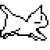

# 🐱 AI Cat Control Desktop (NekoDesk)

<p align="center">
  
</p>

<p align="center">
  <b>A cute desktop automation pet with real-time screen streaming, physical anti-sleep mouse jiggler, and multi-model AI computer control.</b>
</p>

<p align="center">
  <a href="https://play.google.com/store/apps/details?id=com.miniverse.hub"></a>
  
  
  
</p>

---

## 💖 Support This Project / Production Tools
If you find this project helpful or want to support ongoing production engineering, please check out our companion production app on Google Play:

📱 **[Mini App Hub: PDF & AI Tools – Apps on Google Play](https://play.google.com/store/apps/details?id=com.miniverse.hub)**
> Buy token packs or get premium support to help fund our open-source AI desktop agents & workflows!

---

## ✨ Features

- 🐾 **Real Animated Desktop Cat HUD**:
  - Live animated pixel cat directly on your desktop that reacts in real-time:
    - **IDLE**: Sitting, blinking, yawning, and drifting into sleeping `zZz` animations.
    - **PATROL**: Walking & strolling cat animation during anti-sleep keep-alive.
    - **RUNNING**: Fast-paced paw typing & running cat with electrical sparks while executing tasks.
    - **DONE**: Joyful celebration cat jumps on success.
  - **Clickable Buttons on HUD**:
    - **🛑 STOP**: Emergency abort button directly on the overlay.
    - **☕ Keep: OFF / ON**: Toggle the anti-sleep mouse patrol instantly without opening any browser.
- ☕ **Smart Keep-Alive / MoveMyCursor Jiggler**:
  - Natural smooth circular mouse orbits.
  - Native Windows OS lock prevention (`SetThreadExecutionState`).
  - **Polite Human Detection**: Instantly pauses for 10 seconds whenever you move or click your physical mouse, so it never fights for control.
- 🌐 **Web Remote Control & Streaming**:
  - Real-time desktop streaming via WebSocket.
  - Displays live cursor position, visual click ripples, interactive task input, and timestamped execution logs.
- 🤖 **100% Local Capable or Cloud AI**:
  - Run completely **offline & free** using local engines (LM Studio, Ollama).
  - Or connect with cloud vision powerhouses (Gemini, OpenRouter, Groq).

---

## 🧠 Recommended AI Models (Vision & Local)

### 🥇 1. Best Vision Models (For accurate desktop UI button & icon detection)
| Model | Type | Why It's Best | Recommended Setup |
| :--- | :--- | :--- | :--- |
| **Google Gemini 2.0 Flash / 1.5 Flash** | Cloud API | **Top recommendation.** Ultra-fast latency (~0.8s), native high-resolution screen grounding, and generous free tier. | Set `GEMINI_API_KEY` in `.env` |
| **Qwen 2.5 VL 7B / 72B** | Local or Cloud | State-of-the-art open-weights Vision Language Model for GUI computer-use and coordinate clicks. | Run via Ollama / vLLM / OpenRouter |
| **Claude 3.5 Sonnet** | Cloud API | Industry benchmark for computer-use reasoning and multi-step UI navigation. | Connect via OpenRouter endpoint |

### 💻 2. Best 100% Free & Local Models (No API keys or internet needed)
Run completely private on your own GPU/CPU using [LM Studio](https://lmstudio.ai/) or [Ollama](https://ollama.ai/):
- **`qwen2.5-coder-7b-instruct`** (Default Recommended): Superb structured JSON generation, keyboard shortcuts, and desktop command planning.
- **`qwen2.5-3b-instruct`**: Extremely lightweight (~2GB VRAM), runs smoothly on any laptop CPU.
- **`deepseek-r1-distill-qwen-7b`**: Excellent step-by-step reasoning for complex automated workflows.

---

## 🛠️ Step-by-Step Setup Guide

### Step 1: Clone Repository
```bash
git clone https://github.com/jason-lim110396/ai-cat-control-desktop.git
cd ai-cat-control-desktop
```

### Step 2: Install Python Dependencies
Make sure you have Python 3.10 or newer installed:
```bash
pip install -r requirements.txt
```

### Step 3: Configure Environment Variables
Copy the template `.env.example` to `.env`:
```bash
cp .env.example .env
```
Open `.env` in any text editor:
```env
# Optional: If you want Gemini Vision features
GEMINI_API_KEY=your_gemini_api_key_here

# Optional: If using Local LM Studio (Default is http://localhost:1234/v1)
LM_STUDIO_BASE_URL=http://localhost:1234/v1
QWEN_MODEL_NAME=qwen2.5-coder-7b-instruct

# Optional: Telegram remote control
TELEGRAM_BOT_TOKEN=your_bot_token_from_botfather
ALLOWED_CHAT_ID=your_telegram_chat_id
```
*(If you are running LM Studio locally, you don't even need an external API key!)*

### Step 4: Launch NekoDesk
```bash
python main.py
```
1. The **Cute Animated Cat HUD** will immediately pop up in the bottom-right corner of your desktop.
2. Open your web browser to: **`http://localhost:8000`**
3. You can now control your PC, trigger anti-sleep, and send automation instructions!

---

## 🕹️ How to Use

### 1. Directly on Desktop
- **Move the Cat**: Click and drag anywhere on the cat HUD to position it wherever you like.
- **Toggle Keep-Alive**: Click the `[☕ Keep: OFF]` button on the overlay to toggle anti-sleep mouse patrol on and off.
- **Emergency Stop**: Click `[🛑 STOP]` at any time to instantly cut all active AI operations. Moving your physical mouse violently to the top-left corner also triggers PyAutoGUI's physical `FailSafe`.

### 2. From the Web Console (`http://localhost:8000`)
- **Send Tasks**: Type natural language commands such as:
  - *"Open Edge and search today's weather"*
  - *"Open Notepad and write a greeting message"*
- **Monitor Realtime Stream**: Watch your desktop live stream with visual click circles and real mouse pointer positions.
- **Add Custom Endpoints**: Click `⚙️ Custom Endpoint` to easily connect Groq, OpenRouter, or SiliconFlow with one click.

---

## 📂 Project Architecture

```text
├── cat_frames/          # Pre-rendered high-res animated cat sprite frames
├── templates/
│   └── index.html       # Web remote control console & live stream
├── cat_overlay.py       # Desktop Tkinter HUD with animated cat & controls
├── config.py            # Global runtime state & environment config
├── controller.py        # Mouse, keyboard, and keep-alive jiggler engine
├── custom_models.json   # Custom model presets (OpenRouter, Groq, SiliconFlow)
├── llm_agent.py         # AI planner & automation execution loop
├── main.py              # FastAPI server, WebSocket stream, and Telegram bot
├── oneko.gif            # Base cat spritesheet
├── requirements.txt     # Python package requirements
├── .env.example         # Environment template
└── .gitignore           # Git ignore list (protects .env and secrets)
```

---

## 🔒 Security & Privacy

- All sensitive keys (`.env`) are strictly excluded via `.gitignore`.
- Full user sovereignty: you can abort control in a fraction of a second via the desktop HUD button or corner mouse flick.

---

## 📄 License
This project is open-source under the [MIT License](LICENSE).
